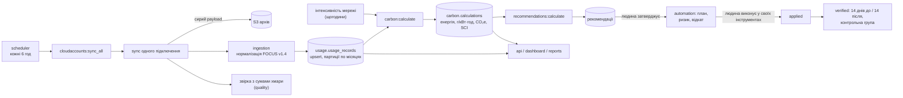
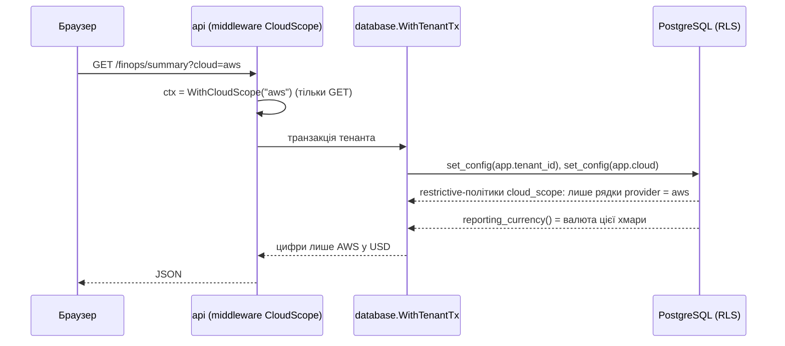
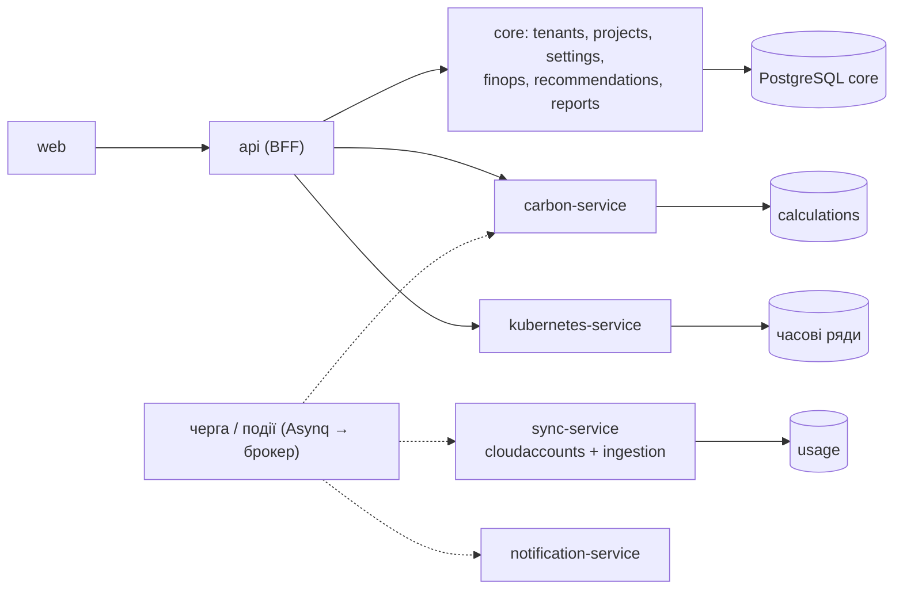

<div align="center">

# Reliabilix GreenOps Platform

**Вартість і вуглецевий слід хмар в одному вікні: одна хмара за раз, у валюті її рахунку.**
Мультитенантний FinOps + GreenOps SaaS: перетворює біллінг хмар на вартість, SCI, рекомендації
з людським затвердженням, виміряну економію та звіти для аудиту.

`Go 1.27` · `PostgreSQL 18` · `Redis + Asynq` · `Next.js 16` · `OpenAPI 3` · `FOCUS v1.4`

[English](README.en.md) · [Дорожня карта](ROADMAP.md) · [Журнал змін](CHANGELOG.md) · [Версії](VERSIONS.md) · [Рішення (ADR)](docs/adr/) · [Ліцензія](LICENSE)

</div>

---

## Коротко

```
Підключити хмари ─▶ Синхронізація біллінгу ─▶ Нормалізація (FOCUS) ─▶ Енергія × інтенсивність мережі ─▶ CO₂e, SCI
                                                                                   │
                       Виміряна економія ◀─ Людина застосовує ◀─ Рекомендація ◀─ Затвердження
```

- **Вартість і вуглець разом.** AWS, Azure, Google Cloud (і CSV-файли вендорів) нормалізуються до FOCUS v1.4; вуглець рахується
  за формулою SCI Green Software Foundation у версіонованій, незмінній методиці.
- **Одна хмара за раз.** Хмари: різні провайдери зі своєю валютою, метриками й викидами. Overview, Carbon, Recommendations і
  Projects показують одну хмару у валюті її рахунку на її власній арифметиці. Долари США й канадські долари не складаються
  ([ADR-0065](docs/adr/0065-cloud-scope.md)).
- **FinOps.** Прогноз місяця по кожній хмарі, аномалії з причинами, бюджети по хмарах, розрахунок зобов'язань, showback за
  тегами, економіка одиниці, розподіл вартості Kubernetes.
- **Рекомендації, які вимірюються.** Перенесення регіону (з урахуванням residency і затримки), rightsizing; людина
  затверджує, платформа лише планує (нічого не виконує), а ефект **вимірюється** за 14 днів до й після з контрольною групою.
- **Звіти.** CSV / JSON / PDF, GHG Protocol Scope 3 / ESRS E1, розклад і листи; звіт охоплює ті хмари, які ви позначили.
- **CI-ворота.** PASS / WARN / BLOCK для планованих змін інфраструктури; Terraform-провайдер керує проектами, політиками, бюджетами.
- **Чесні дані.** Відсутнє показується як відсутнє; оцінка несе метод; кожна цифра каже, з якого джерела мережі вона; хмара,
  яка перестала віддавати дані, позначається, а не мовчки занижує суму.

## Швидкий старт

```bash
docker compose up --build        # postgres, redis, міграції, api, worker, scheduler, web
open http://localhost:3000       # вхід для розробки, без Auth0 (ENV=dev)
```

Тенант розробки порожній навмисно. Щоб побачити заповнений дашборд:

```bash
make seed-demo     # позначені демо-рядки в базі (у фронтенді немає мок-даних)
make recalc        # реальний вуглецевий рушій і рекомендації над ними
```

Без Docker: `docker compose up -d postgres redis && make migrate && make seed && make run-api`, потім `make web`.

## Щоденні команди

| Команда | Призначення |
|---|---|
| `make test` | юніт-тести, включно з перевіркою «OpenAPI ↔ маршрути» |
| `make test-integration` | справжні PostgreSQL + Redis: RLS на кожній таблиці, права ролей, видалення організації, наскрізний конвеєр |
| `make lint` / `make vuln` | gosec + правила ізоляції модулів / govulncheck |
| `make sqlc` / `make api-types` | перегенерувати репозиторії / типи API фронтенду (CI падає при розбіжності) |
| `make roadmap` | перегенерувати блоки дорожньої карти й опису в цьому файлі та в `ROADMAP.md` |
| `make doctor` | перевірити кожну налаштовану зовнішню інтеграцію |
| `make smoke` | наскрізна перевірка на запущеному стеку |

Підключення зовнішніх сервісів: [`docs/setup/README.md`](docs/setup/README.md). Ключі зовнішніх сервісів живуть у консолі
оператора в запечатаному вигляді, не в змінних середовища ([ADR-0029](docs/adr/0029-integration-credentials-in-the-console.md)).

---

# Повний опис платформи

Нижче весь опис платформи від А до Я: архітектура, модулі, зв'язки, формули, слабкі сторони, зовнішні сервіси, мікросервіси й
майбутнє. Цей розділ **генерується** з [`docs/architecture/platform-full.uk.md`](docs/architecture/platform-full.uk.md)
(`make roadmap`): правте джерело, не блок.

<!-- architecture:start -->
<!-- generated from docs/architecture/platform-full.uk.md: edit that file -->
Документ описує платформу цілком: що вона робить, з чого складається, як модулі пов'язані між собою, звідки беруться дані, **за якими формулами** рахуються вартість, енергія, викиди та рекомендації, де її слабкі місця, які зовнішні сервіси треба підключити і що закладено на майбутнє, зокрема сценарії виносу сервісів.

Версія опису відповідає релізу `0.1.0-alpha.179` (див. [`VERSION`](VERSION), [`VERSIONS.md`](VERSIONS.md)). Рішення й обґрунтування лежать в [`docs/adr/`](docs/adr/), короткі огляди: [`overview.md`](docs/architecture/overview.md), [`platform-architecture.md`](docs/architecture/platform-architecture.md) (російською), модель безпеки: [`../security/model.md`](docs/security/model.md).

> Усе, що написано нижче як «факт», перевірене за кодом. Усе, що є оцінкою або планом, прямо так і позначено.

---

## Зміст

1. [Що це за система і для кого](#1-що-це-за-система-і-для-кого)
2. [Архітектура: діаграми](#2-архітектура-діаграми)
3. [Модулі: що кожен робить і з ким пов'язаний](#3-модулі)
4. [Конвеєр даних і розклад фонових задач](#4-конвеєр-даних-і-розклад-задач)
5. [Мультитенантність, ролі, ізоляція, «область хмари»](#5-мультитенантність-ролі-ізоляція-область-хмари)
6. [Усі формули і правила розрахунків](#6-усі-формули-і-правила-розрахунків)
7. [Як працює платформа: наскрізний приклад](#7-наскрізний-приклад)
8. [Слабкі сторони й обмеження (чесно)](#8-слабкі-сторони-й-обмеження)
9. [Зовнішні сервіси: що підключено і що треба підключити](#9-зовнішні-сервіси)
10. [Мікросервіси: перспектива і що закладено на майбутнє](#10-мікросервіси-і-майбутнє)
11. [Експлуатація: спостережність, резервні копії, випуски](#11-експлуатація)

---

## 1. Що це за система і для кого

**Reliabilix GreenOps** — мультитенантний SaaS (FinOps + GreenOps), який перетворює облачний біллінг на:

- **вартість** у валюті, у якій її виставлено, з прогнозом, бюджетами, аномаліями, showback за тегами, порадами щодо зобов'язань (Savings Plans / резервацій);
- **вуглецевий слід** (операційні викиди CO₂e, SCI — Software Carbon Intensity) з урахуванням вуглецевої інтенсивності енергосистеми регіону;
- **рекомендації** (перенесення навантаження в чистіший регіон, ресайзинг), їх **людське затвердження**, план змін (без автоматичного виконання) і **виміряний ефект** після застосування;
- **звіти** (CSV / JSON / PDF, GHG Protocol Scope 3 / ESRS E1), розклад звітів, **CI-ворота** (PASS / WARN / BLOCK) для планованих змін інфраструктури.

Принципи, які проходять крізь усе:

1. **Без вигадування.** Відсутні дані показуються як відсутні; оцінки несуть метод і впевненість; ніколи не «нуль замість невідомо».
2. **Нічого не змінюється у продакшені без рішення людини** й запису аудиту.
3. **Безпека конструктивно:** ізоляція в базі даних (RLS), секрети клієнтів не зберігаються відкритим текстом, мінімальні привілеї.
4. **Виносити сервіс лише за виміряним тригером** ([ADR-0005](docs/adr/0005-service-extraction-triggers.md)).
5. **Хмари — окремі провайдери.** AWS, Azure, GCP мають різні валюти, метрики, викиди; їх **не складають в одну суму** — платформа показує одну хмару за раз у валюті її рахунку ([ADR-0065](docs/adr/0065-cloud-scope.md)).

---

## 2. Архітектура: діаграми

### 2.1. Контекст: платформа і все навколо

```mermaid
flowchart TB
    subgraph people["Люди і машини"]
        user["Користувач (браузер)"]
        operator["Оператор платформи<br/>/operator"]
        ci["CI-пайплайн<br/>ключ grk_, POST /ci/evaluate"]
        tf["Terraform-провайдер<br/>ключ iac"]
        agent["Kubernetes-агент<br/>ключ agent, Kepler → Prometheus"]
        idp["IdP клієнта<br/>SCIM /scim/v2"]
    end

    subgraph platform["Reliabilix GreenOps (модульний моноліт)"]
        web["web: Next.js 16<br/>сесія Auth0, /api/proxy"]
        api["api: Go, chi, RBAC"]
        worker["worker: Asynq"]
        sched["scheduler: cron"]
    end

    subgraph store["Сховища"]
        pg[("PostgreSQL 18<br/>схема на домен, RLS")]
        redis[("Redis 7<br/>черга Asynq")]
        s3[("S3 / MinIO<br/>звіти, сирий біллінг")]
    end

    subgraph clouds["Хмари клієнтів (read-only)"]
        aws["AWS: STS AssumeRole,<br/>Cost Explorer, FOCUS-експорт S3"]
        azure["Azure: Cost Management,<br/>експорт у Blob, service principal"]
        gcp["GCP: BigQuery billing export"]
        vendors["SaaS-вендори:<br/>CSV-файли витрат"]
    end

    subgraph grid["Дані про енергосистему"]
        em["Electricity Maps (платний)"]
        entsoe["ENTSO-E (токен)"]
        free["Energy-Charts, IESO,<br/>Hydro-Québec, EIA, ONS,<br/>UK Carbon Intensity"]
        ember["Ember (місячні нац. середні)"]
        wt["WattTime (маргінальна, готово)"]
    end

    subgraph ext["Інше"]
        auth0["Auth0 (OIDC, MFA)"]
        ecb["ЄЦБ: курси валют"]
        pay["Платежі: Stripe, Paddle,<br/>LiqPay, WayForPay, інвойс"]
        chan["Канали клієнта:<br/>SMTP, webhook, Slack"]
        obs["Prometheus, Grafana,<br/>Tempo, Loki, Sentry"]
    end

    user --> web --> api
    operator --> web
    ci --> api
    tf --> api
    agent --> api
    idp --> api
    user -. вхід .-> auth0
    auth0 -. JWKS .-> api

    api <--> pg
    worker <--> pg
    sched --> redis
    api --> redis
    worker <--> redis
    worker <--> s3
    api <--> s3

    worker --> aws
    worker --> azure
    worker --> gcp
    worker --> vendors
    worker --> em
    worker --> entsoe
    worker --> free
    worker --> ember
    worker -. готово .-> wt
    worker --> ecb
    worker --> chan
    api --> pay
    platform -.-> obs
```



Як читати: людям і машинам видно лише `web`/`api`. Усе довге й залежне від зовнішніх систем виконує `worker` за розкладом `scheduler`. Процеси ділять лише PostgreSQL, Redis і об'єктне сховище, прямих викликів між ними немає.

### 2.2. Шари всередині моноліту

```mermaid
flowchart LR
    subgraph app["internal/app — корінь композиції"]
        wire["провайдери портів: адаптери між доменами,<br/>реєстр інтеграцій, маршрути"]
    end

    subgraph dom["Домени (однакові шари: domain / application / repository / http)"]
        tenants["tenants<br/>організації, учасники, ключі, SSO"]
        projects["projects<br/>проекти, політики,<br/>команди, розподіл"]
        cloudaccounts["cloudaccounts<br/>підключення, синхронізація,<br/>звірка даних"]
        ingestion["ingestion<br/>нормалізація у FOCUS"]
        usage["usage<br/>записи витрат, теги"]
        carbon["carbon<br/>енергія, інтенсивність, SCI, CI-ворота"]
        finops["finops<br/>валюти, бюджети, прогноз,<br/>аномалії, зобов'язання, showback"]
        recs["recommendations<br/>region shift, rightsizing,<br/>перевірка ефекту"]
        automation["automation<br/>плани змін"]
        kube["kubernetes<br/>енергія й вартість воркладів"]
        reports["reports<br/>звіти, розклад"]
        dash["dashboard<br/>читальні моделі Overview"]
        notif["notifications<br/>outbox, канали"]
        alerts["alerts<br/>бюджет, підключення"]
        lic["licensing<br/>плани, підписки, платежі"]
        settings["settings<br/>каталог налаштувань"]
        lifecycle["lifecycle<br/>експорт, видалення, ретеншн"]
        operator["operator<br/>консоль, метадані"]
        users["users<br/>профілі"]
    end

    subgraph plat["internal/platform/* — спільні пакети без бізнес-логіки домену"]
        pdb["database, auth, http,<br/>queue, storage, secretbox"]
        pfocus["focus, fxrates, geo,<br/>methodology, pricing"]
        pinfra["settings, integrations, notify,<br/>audit, errlog, i18n, observability,<br/>readcache, apiusage, plans, entitlements"]
    end

    app --> dom
    dom --> plat
    dom -. "тільки порти (інтерфейси)" .- dom
```



Правило, яке перевіряє лінтер: **домени не імпортують один одного**. Взаємодія — через порти (інтерфейси у `domain`), реалізовані в `internal/app`.

### 2.3. Конвеєр даних



### 2.4. Область «одне облако»



---

## 3. Модулі

### 3.1. Домени

| Модуль | Призначення | Основні схеми | Ключові зв'язки |
|---|---|---|---|
| `tenants` | організації, учасники, запрошення, API-ключі, ролі (в т.ч. власні), SSO-домени, SCIM | `tenants` | видає `tenant_id` і права всім іншим; Auth0 доводить особу, тенант і роль беруться з БД ([ADR-0004](docs/adr/0004-auth0-managed-oidc.md)) |
| `projects` | проекти, функціональні одиниці SCI, політики регіонів (data residency), команди, середовища, правила розподілу | `projects` | пороги CI-воріт, дозволені регіони, одиниці для SCI і unit economics |
| `cloudaccounts` | підключення хмар (AWS / Azure / GCP), запуски синхронізації, звірка з сумами хмари, знімки зобов'язань, rightsizing-знахідки | `cloudaccounts` | постачальники в `providers/{aws,azure,gcp}`; віддає сирі пакети в `ingestion` |
| `ingestion` | нормалізація в FOCUS v1.4: AWS Cost Explorer та експорт, Azure Cost API та експорт, GCP BigQuery, CSV вендорів | — | пише через порт у `usage`; нормалізатори `awsce`, `awsceusage`, `awsexport`, `azurecost`, `azureexport`, `gcpbilling`, `costcsv` |
| `usage` | факти витрат (`usage_records`, партиції по місяцях), теги вартості, імпорти | `usage` | джерело правди для всіх вартостей |
| `carbon` | енергія, вуглецева інтенсивність (багато джерел), CO₂e, SCI, версії методики, CI-ворота, поради щодо часу запуску | `carbon` | читає `usage`, пише `calculations`; публікує дані для `recommendations`, `dashboard`, `reports` |
| `finops` | валюти і курси, зведення вартості, бюджети, прогноз, аномалії, зобов'язання, showback, ціни регіонів | `finops` | читає `usage`; бюджети живлять `alerts` |
| `recommendations` | генерація (region shift, rightsizing, K8s), життєвий цикл, перевірка ефекту | `recommendations` | читає `carbon`, `finops`, політики з `projects` |
| `automation` | перетворення затвердженої рекомендації на план: ризик, кроки, відкат; результат повідомляє людина | `automation` | **платформа нічого не виконує** ([ADR-0017](docs/adr/0017-automation-plans-not-execution.md)) |
| `kubernetes` | приймання енергії воркладів (Kepler), їх використання й запити; розподіл вартості кластера | `kubernetes` | агент штовхає у `api`; вартість береться з рахунку хмари |
| `reports` | CSV / JSON / PDF, розклад, e-mail-дайджести, GHG Scope 3 | `reports` | читає чужі схеми лише на читання |
| `dashboard` | читальні моделі екрана Overview: тренд, сервіси, регіони, ефективність, активність | — (без таблиць) | композиція над `usage`, `carbon`, `audit` ([ADR-0012](docs/adr/0012-dashboard-read-model.md)) |
| `notifications` | outbox доставки, канали (e-mail, webhook, Slack), повтори | `notifications` | домени публікують у порт `notify`, модуль доставляє |
| `alerts` | оцінка бюджетів і стану підключень, відкриття/закриття алертів | `alerts` | беруть сигнали з `finops` і `cloudaccounts` |
| `licensing` | каталог планів, підписки, платіжні події, нагадування | `licensing` | порт `entitlements` обмежує інші модулі |
| `settings` | каталог налаштувань у коді, значення платформи / організації / оператора, історія | `settings` | екрани адмінки генеруються з каталогу ([ADR-0023](docs/adr/0023-settings-engine.md)) |
| `lifecycle` | експорт даних, видалення організації після пільгового періоду, ретеншн партицій | `platform` | працює роллю `greenops_fanout` |
| `operator` | консоль оператора: метадані організацій, джерела, задачі, інтеграції | `platform` | окрема роль БД і журнал доступу ([ADR-0020](docs/adr/0020-operator-console.md)) |
| `users` | профілі, мова, уподобання | `tenants` | — |

### 3.2. Платформні пакети (`internal/platform`)

| Пакет | Призначення |
|---|---|
| `database` | пул, `WithTenantTx` (контекст тенанта + область хмари), помилки |
| `auth` | перевірка JWT / ключів API, RBAC (`rbac.go`), роль → права |
| `http` (`httpx`) | middleware, відповіді проблем, ліміти, **CloudScope**, CORS, rate limit |
| `queue` | типи задач Asynq, payload із `tenant_id` |
| `storage` | S3 / локальний каталог / пам'ять |
| `secretbox` | шифрування чутливих значень (адреси одержувачів, секрети) |
| `focus` | модель запису FOCUS, валідація (NaN/Inf, валюта) |
| `fxrates` | клієнт референсних курсів ЄЦБ |
| `geo` | регіони хмар, координати, затримки (виміряні та оцінка за відстанню) |
| `methodology` | реєстр версій коефіцієнтів, контрольні суми |
| `pricing`, `awsprice`, `azureprice`, `gcpprice` | індекс цін регіонів, прайс-листи |
| `ec2spec` | форма інстансів (vCPU, пам'ять) |
| `settings`, `integrations`, `plans`, `entitlements` | каталог налаштувань, реєстр зовнішніх ключів, плани, ліміти |
| `notify`, `audit`, `errlog`, `apiusage`, `readcache`, `observability`, `i18n`, `version`, `config`, `billing` | повідомлення, аудит, журнал помилок, бюджети запитів до провайдерів, кеш читання, метрики, мови, версія, конфіг, платіжні провайдери |

### 3.3. Фронтенд

Next.js 16, React 19, TypeScript, Tailwind, TanStack Query, Zustand, ECharts. Сторінки: Overview, Projects, Kubernetes, Carbon & Energy, Reports, Recommendations, Automation, CI/CD, Connectors, Alerts, Settings, Methodology, консоль оператора. Типи API генеруються з `backend/api/openapi.yaml`; узгодженість маршрутів з контрактом перевіряє тест. Двомовність (каталоги en та ru; англійська — джерело): текст сервера — стабільні коди, дані домену не перекладаються ([ADR-0036](docs/adr/0036-multi-language-platform.md)).

---

## 4. Конвеєр даних і розклад задач

Усі задачі несуть `tenant_id`, ідемпотентні, мають повтори, а помилка «доступ заборонено» не повторюється (позначає підключення як `error`).

| Розклад (UTC) | Задача | Навіщо |
|---|---|---|
| `0 */6 * * *` | `cloudaccounts:sync_all` | по задачі синхронізації на підключення, далі ланцюг sync → ingest → carbon → recommendations |
| `5 * * * *` | `carbon:refresh_grid_intensity` | щогодини інтенсивність мережі (Electricity Maps та додаткові джерела) |
| `40 4 * * *` | `carbon:refresh_monthly` | місячні національні значення (Ember) для регіонів у використанні |
| `10 5 * * *` | `carbon:auto_load_history` | регіони з пропусками: підтягти минуле, перерахувати |
| `30 3 * * *` | `carbon:recalculate_all` | останні 35 днів: підхоплює нові функціональні одиниці (SCI) |
| `30 15,20 * * *` | `finops:refresh_fx` | курси ЄЦБ (публікуються пополудні) |
| `20 3 * * 1` | `recommendations:refresh_price_index` | щотижня: відносна ціна EC2 за регіоном |
| `30 4 * * *` | `recommendations:calculate_all` | переоцінка після змін політик/мережі |
| `45 3 * * *` | `cloudaccounts:rightsizing_all` | знахідки rightsizing (змінюються повільно) |
| `20 * * * *` | `alerts:evaluate_all` | бюджети і підключення |
| `7 * * * *` | `reports:run_schedules` | звіти за розкладом (пн / 1-ше, 06:00) |
| `* * * * *` | `notifications:sweep` | страховка outbox |
| `15 5`, `25 5`, `35 5 * * *` | purge | очищення доставок, помилок, журналу оператора |
| `0 2 * * *` | `platform:ensure_partitions` | партиції на місяці вперед |
| `50 5 * * *` | `platform:enforce_retention` | відкинути партиції за межами ретеншну |
| `10 * * * *` | `lifecycle:erase_due` | видалення організацій після пільгового терміну |
| `5 8 * * *`, `15 * * * *` | licensing | нагадування, завершення підписок |

Окремо: ingestion CSV вендорів (`ingestion:import_cost`), перерахунок за вікно, бекфіл історії мережі (з консолі оператора), доставка повідомлень (швидкий шлях).

---

## 5. Мультитенантність, ролі, ізоляція, «область хмари»

- **Три рівні ізоляції тенанта:** тенант береться з перевіреної особи (не з тіла запиту); RBAC на кожному обробнику; **Row Level Security** з `FORCE ROW LEVEL SECURITY` (роль додатка не суперкористувач і без `BYPASSRLS`). Тест перевіряє: чужий об'єкт за UUID, через експорт і через фонову задачу дає 404.
- **Ролі:** `owner`, `admin`, `engineer`, `viewer`, `billing`, власні ролі організації; ролі машин: `ci`, `agent`, `scim`, `iac`; права — набір `Permission` (наприклад `cloud:write`, `recommendation:apply`, `automation:approve`, `tenant:data`). Ключі машин (`grk_`, `iac`, `agent`) мають вузький набір прав.
- **Секрети:** облікові дані клієнтів не зберігаються: AWS — роль з External ID; GCP — доступ до датасету; Azure — service principal, секрет запечатаний; ключі зовнішніх сервісів платформи — у реєстрі інтеграцій, запечатані ([ADR-0010](docs/adr/0010-secrets-management.md), [ADR-0029](docs/adr/0029-integration-credentials-in-the-console.md)).
- **Область хмари** ([ADR-0065](docs/adr/0065-cloud-scope.md)): запит з `?cloud=` (або списком `aws,azure` для звітів) прив'язує транзакцію до налаштування `app.cloud`; restrictive-політики (`cloud_scope`) на `usage_records`, `tagged_cost`, `calculations`, `recommendations`, `connections` приховують чужі хмари у **кожному** запиті. Запис ніколи не звужується. Валюта звітності в такому запиті — власна валюта хмари.
- **Видалення організації** виконує роль `greenops_fanout` по кожній таблиці з `tenant_id`; тест `TestEveryTenantTableCanBeErased` ловить таблицю без прав.

---

## 6. Усі формули і правила розрахунків

Нижче — те, що реалізовано в коді. Файли вказано, щоб формулу можна було перевірити.

### 6.1. Вартість

**Джерело:** AWS Cost Explorer / FOCUS-експорт, Azure Cost Management, GCP BigQuery, CSV вендорів → **FOCUS v1.4**. Суми — `numeric`; `NaN`/`Inf` і невірний код валюти відкидаються до запису. Імпорт ідемпотентний (upsert за ключем рядка).

**AWS Cost Explorer:** відкритий місяць позначається як *estimated*. Такі дні **зберігаються**, а вікно синхронізації перечитує поточний місяць (і попередній у перші 5 днів) до фіналізації.

**Валюти.**
- Валюта звітності: явний вибір організації/платформи; інакше — **валюта з найбільшим обсягом витрат за 90 днів у євро-еквіваленті** за найновішим курсом (`finops.reporting_currency`, міграція 0079). У запиті з областю хмари — валюта цієї хмари.
- Перерахунок: `amount_to = amount_from × rate_to / rate_from`, де `rate` — «одиниць валюти за 1 EUR» за курсом ЄЦБ **на день запису**, а якщо дня немає — найближчий попередній у межах 10 днів. Сума без курсу **не** входить до підсумків, і інтерфейс каже, яка валюта і скільки рядків.
- Суми різних валют **ніколи не складаються** у підсумках області хмари; перерахунок використовується лише там, де людина явно просить одну валюту (звіти по різних валютах залишаються окремими рядками).

**Свіжість даних хмари:** `behind_days = (сьогодні − останній_день_з_даними) − 1`; відставання > 2 днів позначається і попереджає про заниження сум.

**Звірка з хмарою** (`cloudaccounts/domain/quality.go`): для кожного дня `diff = |stored − provider|`, допуск = `max(0.05, |provider| × 0.5%)`; розбіжність повертає курсор синхронізації назад. Якщо хмара не надає контрольних сум — статус «не перевірено» з причиною.

### 6.2. Енергія

Методика версіонується, **неперероблювана**: зміна числа = нова версія (`RLX-CCF-1`, статус `provisional`; [ADR-0040](docs/adr/0040-ccf-coefficients.md)). Коефіцієнти:

| Величина | Значення | Походження |
|---|---|---|
| `vcpu_hours` | 0,00212 кВт·год / vCPU-год = 0,74 + 0,5 × (3,5 − 0,74) Вт | константи CCF (середнє AWS, 50% завантаження) |
| `memory_gb_hours` | 0,000392 кВт·год / ГБ-год | константа CCF |
| `storage_gb_months` | 0,0004745 кВт·год / ГБ-міс. (HDD 0,65 Вт·год/ТБ·год × 730 год) | константа CCF |
| `PUE` | 1,135 | CCF `PUE_AVG` |
| `cost_based_kwh_per_usd` | compute 0,9; storage 0,35; database 0,7; networking 0,12; other 0,25 | **оцінки авторів, не з джерела** |
| `embodied_g_per_kwh` | 0 | embodied не включено |

**На основі використання (usage-based):**

```
E_кВт·год = обсяг × коефіцієнт_одиниці × PUE
```

**На основі вартості (cost-based)** — лише якщо вимірюваного використання немає:

```
E_кВт·год = max(0, витрати_USD) × кВт·год_на_USD(категорія) × PUE
```

Рядок cost-based **відкидається**, якщо для того ж сервісу, регіону й дня є виміряний рядок (щоб не подвоювати енергію). Cost-based працює лише для USD (інші валюти спершу конвертуються). Хмарні регіони без регіону/«global» пропускаються з причиною `no_region`.

Для **інстансів** (рекомендації): `місячна_енергія = 730 × (vCPU × 0,00212 + ГБ × 0,000392) × PUE`.

### 6.3. Інтенсивність енергосистеми

Джерела **не усереднюються**: політика ([ADR-0035](docs/adr/0035-multi-source-grid-intensity.md), [ADR-0045](docs/adr/0045-aggregation-and-source-policy.md)) бере **перше довірене джерело, у якого достатньо даних**. Порядок спроб для дня:

1. `day_mean` — середнє щонайменше `MinDayReadings` показань цього дня в першому джерелі, де їх достатньо;
2. `month_mean` — опубліковане місячне національне середнє (Ember), якщо погодинних немає;
3. `partial_day_mean` — менше показань, ніж хоче політика (нижча впевненість);
4. `latest_before` — останнє показання до дня, не старше допустимого віку (для джерела свій ліміт);
5. `latest_overall` — найновіше існуюче значення, як **оцінка**;
6. запит до провайдера наживо, якщо нічого не збережено.

Кожен рядок розрахунку зберігає джерело й основу (`basis`). Середня й **маргінальна** інтенсивність зберігаються окремо, ніколи не змішуються. Інтенсивність генерації, обчислена з генерації за типами (ENTSO-E, EIA, Energy-Charts, IESO, ONS), — **обчислена, не виміряна**: життєві цикли за паливом застосовуються до публічної генерації без урахування перетоків.

### 6.4. Викиди та SCI

```
грами_CO₂e = E_кВт·год × I_г/кВт·год + M_г           (M = E × embodied_g_per_kwh = 0)
CO₂e_кг    = грами / 1000
SCI        = ((E × I) + M) / R                        (г CO₂e на одиницю R)
```

`R` — функціональні одиниці, які повідомив клієнт за день; **без `R` SCI = `null`**, не оцінка. Частка SCI дня розподіляється по рядках: `SCI_рядка = грами_рядка / R_дня`.

Перерахунок під іншою версією методики можливий і не переписує історію ([ADR-0026](docs/adr/0026-methodology-registry-and-comparison.md)).

### 6.5. Kubernetes

**Енергія воркладу:** агент штовхає годинні вибірки (Kepler → Prometheus): `energy_kwh` + використання/запити CPU і пам'яті; межа правдоподібності `5000 кВт·год/год` відсікає помилку одиниць.

**Розподіл вартості кластера** ([ADR-0063](docs/adr/0063-kubernetes-cost-allocation.md)):

```
вартість_дня = вузли кластера з рахунку хмари
CPU-частка   = 0,65 вартості;   пам'ять = 0,35
утримання    = max(запит, використання) на годину (ядро-год, ГіБ-год)
частка воркладу = (його утримання) / (сума утримань) — окремо для CPU та пам'яті
idle         = ємність вузлів − сума утримань (лише якщо агент передав ємність; інакше «невідомо», не нуль)
waste        = (запит − використання) × ціна одиниці (лише де є запити)
```

K8s-енергія **є частиною** енергії хмари і **ніколи не додається** до підсумків (інакше подвійний облік).

### 6.6. Прогноз місяця

[ADR-0053](docs/adr/0053-forecast-anomaly-drivers-unit-economics.md). Для **кожної хмари окремо** (її ритм і затримка), потім сума:

1. Хвостові дні, у яких вартість `< 70 %` типового для цього дня тижня, вважаються недоданими (не більше 2): їх прогнозують як майбутні, щоб затримка експорту не читалася як економія.
2. Очікувана вартість майбутнього дня = **медіана того ж дня тижня за 6 тижнів** × тренд, де тренд = середнє останніх 14 довірених днів / попередніх 14, в межах **0,8–1,25**.
3. Смуга (80 %): `±1,2816 × σ_похибок × √(днів)`, де σ — розкид помилок цього ж правила на довірених днях (до 28).
4. Підсумок за кілька хмар: очікування складаються, смуга — як корінь із суми квадратів.
5. Менше 14 довірених днів → метод `linear`: `витрачено × (днів_періоду / днів_від_першого_дня_даних)`, і це написано.

### 6.7. Аномалії

За кожною хмарою окремо: день аномальний, якщо

```
вартість > середнє(попередні ≤14 днів) + 3 × σ,   σ > 0, попередніх днів ≥ 7
```

Пояснення (до 3 драйверів): сервіс × регіон з найбільшим зростанням порівняно з середнім за 14 днів до цього; пара без історії позначається `new`.

### 6.8. Бюджети

`used_pct = витрачено / сума × 100`; прогноз — як у п. 6.6 у валюті бюджету; стан: `ok`, `at_risk` (за прогнозом чи порогом), `exceeded`. **Бюджет може належати хмарі** — тоді міряється на її власних витратах у валюті бюджету.

### 6.9. Зобов'язання (Savings Plans / резервації)

[ADR-0051](docs/adr/0051-commitments-report.md), [ADR-0054](docs/adr/0054-existing-commitments-and-controlled-verification.md). Звіт, нічого не купується.

```
committable_day = витрати на compute + бази даних за день
baseline        = рівень, який досягається або перевищується у 80 % днів (перцентиль 0,20)
covered_daily   = baseline × coverage%            (типово 70 %)
monthly_covered = covered_daily × 30,4
commitment/год  = covered_daily × (1 − знижка) / 24
monthly_saving  = monthly_covered × знижка%       (при повному використанні)
break_even      = 100 − знижка%
сценарій u      = monthly_covered × (u/100 − (1 − знижка))     u ∈ {100, 80, 60}
```

Орієнтовні знижки (можна змінити): AWS 25 % (1 р.) / 40 % (3 р.); Azure 15 / 35; GCP 28 / 46. Менше 14 днів — «недостатньо даних». Якщо існуюче покриття відоме (прочитане з AWS чи введене), порада: `buy` / `hold` / `reduce` (використання < 90 %).

### 6.10. Showback за тегами

[ADR-0061](docs/adr/0061-showback-by-cloud-tags.md): вартість розбивається за значеннями одного ключа тегу; рядки без значення — `Untagged`, **ніколи не розкидаються**. `coverage = tagged / total × 100`. Показується день, з якого теги читаються.

### 6.11. Економіка одиниці

`cost_per_unit = витрати днів зі звітом одиниць / одиниці`; `carbon_g_per_unit` так само. Лише дні, за які клієнт повідомив одиниці. Порівняння місяців — якщо в обох не менше 7 днів. Масштаб показу підбирається автоматично (на 1 / 1 000 / 1 000 000 одиниць).

### 6.12. Рекомендація «перенести регіон»

[ADR-0013](docs/adr/0013-recommendations-human-approval.md), [ADR-0046](docs/adr/0046-measured-inter-region-latency.md).

```
масштаб_місяця = 30 / довжина_вікна_днів
зниження_%     = (I_поточна − I_кандидата) / I_поточна × 100
зниження_кг/міс = CO₂e_кг_вікна × масштаб × (I_поточна − I_кандидата)/I_поточна
якщо I_кандидата ≥ I_поточна → 0
впевненість    = min(0,9; (0,5 + 0,4 × min(1, зниження_% / 50)) × min(1, днів_даних/30))
зміна_вартості = витрати × масштаб × (ціна_кандидата / ціна_поточного − 1)   (лише за індексом цін)
```

**Жорсткі правила:** лише регіони зі списку дозволених проекту (порожній список = нічого не пропонується); лише в межах тієї ж хмари; пропонується регіон, у якого `зниження ≥ 10 %` і `≥ 1 кг/міс`, затримка в межах бюджету (типово **60 мс**); вибирається найбільше зниження, при рівності — найближчий. Вартість — «не оцінено», якщо немає індексу цін для обох регіонів.

**Затримка:** якщо опубліковано виміряну пару (Azure — Microsoft; AWS — CloudPing, медіана за рік), береться більше з двох напрямків; інакше `оцінка = intercept + per_km × відстань` за прямою, підігнаною до тисяч виміряних пар, із вказаною типовою похибкою (80 % пар у межах `p80`).

На дашборді **ефект перенесення регіону** в зведенні рахується обережно: `збереження = CO₂e_кг_регіону × (I_тепер − I_кандидата)/I_тепер` — миттєва інтенсивність ніколи не множиться на енергію всього періоду.

### 6.13. Rightsizing

AWS: знахідки rightsizing від провайдера (Cost Explorer) + модельований вуглецевий ефект: `Δкг = (місячна_енергія(поточна форма) − місячна_енергія(цільова форма)) × інтенсивність регіону / 1000`, де `місячна_енергія = 730 × (vCPU × 0,00212 + ГБ × 0,000392) × PUE`; форма невідома → ефект не оцінюється. Kubernetes: на основі виміряних запитів і використання (перцентилі — наступний крок, [ADR-0031](docs/adr/0031-kubernetes-rightsizing.md)).

### 6.14. Перевірка ефекту

[ADR-0025](docs/adr/0025-verified-impact.md), [ADR-0054](docs/adr/0054-existing-commitments-and-controlled-verification.md).

```
база   = 14 днів до застосування
після  = 14 днів після пропуску 3 днів (затримка експорту)
мін. днів у вікні = 10, інакше inconclusive (нічого не екстраполюється)
виміряно_кг/міс = (середнє_базових − середнє_після) × 30
реалізація_%    = виміряно / очікувано × 100
результат: ≥ 80 % realized · 20–80 % partial · < 20 % not_realized
через 60 днів без даних — закриваємо як inconclusive
```

**Контрольна група** (решта сервісів проекту): використовується, лише якщо її добова вартість ≥ 30 % цільової й зростання між вікнами в межах 0,5–2,0; тоді вимірювання коригується на тренд решти проекту, метод `before_after_vs_control`. Метод не керує змінами навантаження, і це записано в самому результаті.

### 6.15. CI-ворота

`Gate(Δкарбон, Δвартість, пороги)`: враховуються **лише збільшення**; зменшення ніколи не блокується; `BLOCK` сильніший за `WARN`. Пороги — на проект, на місяць: `carbon_warn/block_kg`, `cost_warn/block`. Оцінка змін грунтується на тих самих моделях енергії (п. 6.2) і поточній інтенсивності регіону.

### 6.16. Звіт GHG Protocol Scope 3 / ESRS E1

[ADR-0055](docs/adr/0055-ghg-scope3-report.md): категорія 3.1 «придбані товари й послуги»; валовий підсумок і енергія у `tCO₂e`, частка виміряного використання проти оцінки з витрат; за провайдером, місяцем, сервісом (топ-25). Embodied (3.2) = 0 з поясненням; Scope 1/2 організації — не покрито. При статусі методики `provisional` звіт прямо каже, що він непридатний до публічного заяви.

---

## 7. Наскрізний приклад

1. Власник підключає AWS (роль + External ID) і Azure (service principal).
2. Планувальник ставить `sync_all`. Worker читає Cost Explorer (USD) та Azure (CAD), архівує сирі дані в S3.
3. `ingestion` нормалізує в FOCUS і робить upsert у `usage_records` (кожен рядок має свою валюту).
4. Сервіс перевіряє дні проти сум хмари, оновлює «дані до такої-то дати».
5. `carbon:calculate`: для кожного (провайдер, сервіс, регіон, день) знаходить кількість або вартість, обирає інтенсивність (п. 6.3), рахує `CO₂e`.
6. `recommendations:calculate` пропонує перенесення EC2/RDS із `eu-central-1` у чистіший регіон з урахуванням політики регіонів, затримки й індексу цін.
7. Власник у Overview обирає вкладку **AWS (USD)** — усі цифри тільки AWS у доларах; вкладка **Azure (CAD)** — тільки Azure у канадських доларах.
8. Рекомендацію затверджує людина → `automation` будує план з ризиком і відкатом → людина виконує у своїх інструментах → через 17 днів платформа **вимірює** фактичний ефект.
9. Щомісяця за розкладом формується звіт (за обраними хмарами проекту) і надсилається учасникам.

---

## 8. Слабкі сторони й обмеження

Усе нижче — відомі й записане в документації, не приховується.

**Дані й методика**
- Коефіцієнти `RLX-CCF-1` — **provisional**: usage-based взято з констант CCF (середні, не по типу інстансу), **cost-based — оцінки авторів без джерела**. Для зовнішньої звітності потрібна верифікація (аудит, звірка з CCF і звітами хмар, [`08-phases.md`](docs/product/08-phases.md)).
- **Embodied emissions (M в SCI) не враховано** — лише операційні викиди. Market-based облік і водоспоживання відсутні.
- Для більшості джерел інтенсивність **обчислена** з генерації, а не виміряна; перетоки між зонами не враховано.
- Cost-based енергія залежить від ціни, а не від споживання: знижка/зобов'язання «зменшують» енергію хибно (це зафіксовано як низька впевненість).
- Пам'ять VM і керовані диски Azure не вимірюються (лише вартісна оцінка).

**Прогнози та ефекти**
- Прогноз — сезонний за днем тижня; не враховує одноразових подій, зміни тарифів, сезонності довшої за 6 тижнів.
- Перевірка ефекту порівнює «до/після» і контрольну групу; не відокремлює зміни навантаження повністю.
- Індекс цін регіонів — для EC2 і кількох керованих сервісів; для решти економія «не оцінено».

**Інженерні**
- Одна PostgreSQL: RLS додає вартість на кожне читання; партиціонування по місяцях, але горизонтального масштабування запису немає.
- Redis і `scheduler` — по одному екземпляру (немає лідер-виборів; `scheduler` має бути лише один).
- Інтеграції AWS/Auth0/S3 покриті фейками й інтеграційними тестами, але не всі перевірені на живих сервісах.
- Кеш читання (`readcache`) — у пам'яті процесу; між репліками API не ділиться.
- Один інтеграційний тест видалення організації раніше падав (права `greenops_fanout`): виправлено в `0083`, тест тепер ловить таке в CI.

**Продукт**
- Немає коннектора DigitalOcean; інші SaaS — лише через CSV-файли.
- Немає читання існуючих зобов'язань для Azure/GCP (ручне введення).
- Автоматичних виконавців (Terraform / Kubernetes) немає за задумом: платформа лише планує.
- Бюджети в алертах не називають хмару в тексті.

---

## 9. Зовнішні сервіси

### 9.1. Уже підключено або готово

| Сервіс | Призначення | Стан |
|---|---|---|
| Auth0 (OIDC) | вхід, MFA | потрібні `AUTH0_*` у середовищі |
| AWS (STS, Cost Explorer, S3 FOCUS, прайс-лист) | біллінг клієнта | ролі клієнта read-only |
| Azure (Cost Management, Blob, Retail Prices) | біллінг клієнта | service principal |
| Google Cloud (BigQuery billing export, Catalog) | біллінг клієнта | доступ до датасету |
| ЄЦБ | референсні курси валют | без ключа |
| Electricity Maps | погодинна інтенсивність | платний ключ; **денний бюджет запитів вичерпується** — потрібен план |
| ENTSO-E | генерація за типами (Європа) | **працює**: токен прийнято, бекфіл 30 днів для `eu-central-1`, `eu-north-1`, `eu-west-1`, `eu-west-3` (Велика Британія в цьому джерелі не покрита) |
| Energy-Charts, IESO, Hydro-Québec, UK Carbon Intensity | безкоштовні джерела | без ключа |
| EIA, Ember, ONS, Climate TRACE | США, місячні нац., Бразилія, інвентар | ключ там, де потрібно |
| S3 / MinIO | звіти, сирий біллінг | `S3_BUCKET` |
| SMTP | листи | у розробці лише логуються |
| Prometheus / Grafana / Tempo / Loki / Sentry | спостережність | у `deploy/observability` |

### 9.2. Що ще треба підключити

| Що | Навіщо | Пріоритет |
|---|---|---|
| **Платний план Electricity Maps** (або WattTime) | погодинна точна інтенсивність для регіонів без безкоштовних джерел | високий |
| **Auth0 (виробничий тенант)** | реальний вхід, SAML/SSO | високий |
| **SMTP / транзакційна пошта** (Postmark, SES) | запрошення, дайджести, алерти | високий |
| **Об'єктне сховище S3** з KMS | звіти й архів біллінгу | високий |
| **Sentry** | помилки api/worker/web | середній |
| **WattTime** | маргінальна інтенсивність для time-shift | середній |
| **Платіжний провайдер** (Stripe / Paddle / LiqPay / WayForPay) | підписки | коли з'являться платні плани |
| **Slack-додаток / Teams / PagerDuty** | утвердження і алерти в чатах | середній |
| **Реєстр Terraform** | публікація провайдера | низький |
| **DigitalOcean billing API** | ще одна хмара | на запит |
| **Верифікація методики** (CCF-звірка, аудит) | придатність до зовнішньої звітності | перед публічними цифрами |

---

## 10. Мікросервіси і майбутнє

### 10.1. Поточне рішення

Модульний моноліт із трьома процесами (api / worker / scheduler) — свідомий вибір ([ADR-0001](docs/adr/0001-modular-monolith.md), [ADR-0003](docs/adr/0003-no-message-bus-on-start.md)): одна кодова база, одна транзакційна база, чіткі межі модулів, ланцюг задач без брокера подій.

### 10.2. Чому моноліт ще правильний

Межі між доменами вже ті, які були б між сервісами: **порти замість імпортів**, окремі схеми PostgreSQL, окремі ролі БД, ідемпотентні задачі, `tenant_id` у кожному payload. Розрізати можна без переписування логіки.

### 10.3. Тригери виносу ([ADR-0005](docs/adr/0005-service-extraction-triggers.md))

Домен виноситься лише якщо: (1) виміряне навантаження вимагає окремого масштабування; (2) домен перейшов до іншої команди з власним циклом релізів; (3) потрібен інший профіль безпеки/комплаєнсу з фізичною ізоляцією. Кожен винос — окремий ADR.

### 10.4. Імовірні кандидати і чому

| Кандидат | Тригер | Що вже готово |
|---|---|---|
| `ingestion` + `cloudaccounts` (синхронізація) | піки CPU/мережі при великих рахунках; різні SLA на хмари | сирий payload в S3, нормалізатори без залежності від БД, ідемпотентний upsert |
| `carbon` (інтенсивність і розрахунки) | масштабування обчислень; окрема команда даних про мережу | чисті функції `ComputeWith`, версіонована методика, джерела за портом |
| `kubernetes` (часові ряди) | обсяг годинних вибірок | окрема схема; план винести ряди у спеціалізоване сховище, а в PG залишити метадані й агрегати |
| `notifications` | надійність доставки, окремі канали | outbox + sweep, канали-плагіни |
| `reports` (рендер PDF) | важкі генерації | задача з `tenant_id`, файл у S3 |
| `operator` | інший профіль безпеки | окрема роль БД і журнал доступу |

### 10.5. Закладено на майбутнє

- **Contract-first:** `openapi.yaml` перевіряється тестом проти маршрутів; типи фронтенду генеруються.
- **Версіонування методики** — безпечний імпорт опублікованих датасетів без переписування історії.
- **Реєстр інтеграцій** і каталог налаштувань: нові ключі/опції додаються без міграцій коду.
- **Область хмари (`app.cloud`)** — універсальний механізм «зріз даних на рівні БД»: той самий принцип підійде для виділення сервісу по хмарі.
- **Порт `notify`** і outbox — нові канали (Teams, PagerDuty, SMS) без змін доменів.
- **Порт `entitlements`** — ліміти й плани для SaaS-монетизації.
- **Terraform-провайдер** (`terraform-provider-reliabilix`) і CI-ворота — інтеграція в процеси клієнта.
- **K8s-агент** з пакетним образом; план — перцентильний rightsizing.
- **Фаза 3 «Automate»:** виконавці Terraform/Kubernetes з dry-run, ідемпотентним ключем і блокуванням — за окремими облікові даними, завжди за явним затвердженням.
- **DigitalOcean та інші хмари** — інтерфейс (колір, значок, перемикач) уже узагальнений; бракує лише коннектора.

### 10.6. Орієнтовна карта після виносу



Це **можлива** карта, не поточний стан і не зобов'язання: вона виникає лише після спрацювання тригера з п. 10.3.

---

## 11. Експлуатація

- **Спостережність:** метрики Prometheus (`cloud_sync_duration_seconds`, `usage_records_processed_total`, `carbon_calculations_total`), трейсинг Tempo, логи Loki, помилки — у базі та Sentry; `make doctor` перевіряє всі налаштовані інтеграції.
- **Резервні копії:** цілі RPO 15 хв / RTO 4 год; перевірка відновлення `scripts/backup-restore-check.sh` ([`backup-and-recovery.md`](docs/operations/backup-and-recovery.md)). WAL-архівація й PITR залежать від прод-середовища.
- **Продуктивність:** виміряні цифри — [`performance.md`](docs/operations/performance.md) (зведення вартості на млн рядків: 14 с → 1 с після оптимізації валют).
- **Випуски:** `VERSION`, `VERSIONS.md` (версії всіх частин і образів), `CHANGELOG.md`; тег `latest` не публікується; тест `go test ./internal/platform/version/...` перевіряє узгодженість.
- **Дорожня карта** оновлюється автоматично зі `CHANGELOG.md` та стану фаз: [`ROADMAP.md`](ROADMAP.md) (див. `scripts/gen-roadmap.py`).

<!-- architecture:end -->

---

# Дорожня карта

> **Measure → Recommend → Automate**, потім зробити придатним до продажу. Блок нижче генерується: правте `VERSION`,
> `CHANGELOG.md`, `docs/product/08-phases.md`. Повна карта: [`ROADMAP.md`](ROADMAP.md).

<!-- roadmap:start -->
<!-- generated by scripts/gen-roadmap.py from VERSION, CHANGELOG.md and docs/product/08-phases.md: do not edit between the markers -->

**Зараз:** `0.1.0-alpha.179` · стадія **alpha** · контракт API `0.52.0` · міграція схеми `83`

| Фаза | Яку біль закриває | Стан |
|---|---|---|
| 1 | «Мне нужно быстро увидеть пользу» | Готово · alpha.154 (ADR-0052); остаётся живой экран хода первой синхронизации, пример для Azure и GCP |
| 2 | «Разнесите расходы по командам» | Готово · alpha.155–156 (ADR-0053): прогноз, причины аномалий, единичная экономика; команды, окружения и правила распределения уже были. Остаётся showback по тегам облака (нужны теги в коннекторах) |
| 3 | «Платформа показывает, но не делает» | Готово · alpha.157 (ADR-0054): чтение у AWS, совет по покупке, проверка с контрольной группой. Азия/GCP не читаются (нужны реальные аккаунты), для них ручной ввод |
| 4 | «Мне нужно пройти аудит и выдать отчётность» | У роботі · alpha.158 (ADR-0055): отчёт GHG Protocol Scope 3 / ESRS E1 готов; страница доверия `/trust` и черновик DPA готовы (alpha.159); SCIM готов (alpha.160, ADR-0056)… |
| 5 | «Встройте это в мой процесс» | У роботі · alpha.161–162: приглашения письмом со страницей `/invite` и дайджест в письмах по расписанию готовы; alpha.163: событие «план ждёт утверждения» и кнопка в Slack (ссылка в приложение… |
| 6 | «Мне есть что продавать» | У роботі · alpha.165: нагрузочные цифры измерены и опубликованы (`docs/operations/performance.md`), найден и исправлен медленный расчёт валюты (14 с → 1 с)… |

**Останні релізи**

- **0.1.0-alpha.179** (2026-10-12): The cloud switch is a slim pill
- **0.1.0-alpha.178** (2026-10-12): The README is the full description
- **0.1.0-alpha.177** (2026-10-12): README rewritten; Full platform description in Ukrainian; Commercial licence
- **0.1.0-alpha.176** (2026-10-12): Erasing an organization failed whenever it had a report schedule, a commitment snapshot or a support view
- **0.1.0-alpha.175** (2026-10-12): No "all clouds" total anywhere on the Overview; Connectors and an account's page show a connection's cost in the currency it is billed in; Reports choose their clouds; Budgets can belong to a cloud
- **0.1.0-alpha.174** (2026-10-12): AWS cost of the open month was never read; Month-end forecast, "spent so far", budget and run-rate were wrong with two clouds; Cost per request showed `0.0001 CAD`; The "auto" reporting currency changed with the window; … і ще 5

<!-- roadmap:end -->

**Принципи**

1. **Без вигадування:** відсутнє показується як відсутнє; оцінки несуть метод і впевненість.
2. **Нічого не змінюється у продакшені без рішення людини** й запису аудиту.
3. **Безпека конструктивно:** ізоляція в базі, секрети клієнтів не зберігаються, мінімальні привілеї.
4. **Сервіс виноситься, лише коли спрацював виміряний тригер** ([ADR-0005](docs/adr/0005-service-extraction-triggers.md)).
5. **Хмари не складаються через валюти** ([ADR-0065](docs/adr/0065-cloud-scope.md)).

# Ліцензія

Комерційна, пропрієтарна. © 2026 Reliabilix Systems. Усі права захищено. Використання платформи (хостингове чи власне)
потребує угоди з Reliabilix Systems; див. [`LICENSE`](LICENSE). Сторонні компоненти й публічні джерела даних зберігають власні
ліцензії та умови.
