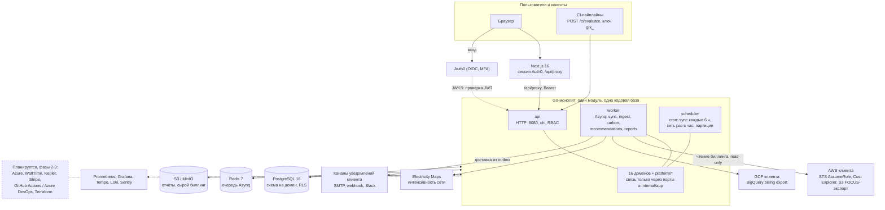
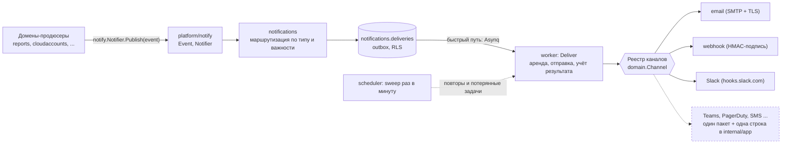

# Архитектура Reliabilix GreenOps Platform

Сводный документ на русском: что за система, как устроена, с чем соединяется. Детали решений лежат в [`docs/adr/`](../adr/), краткий англоязычный обзор конвейера — в [`overview.md`](overview.md), модель безопасности — в [`../security/model.md`](../security/model.md).

## 1. Обзор и схема связей

Reliabilix GreenOps — мультитенантный SaaS, который превращает облачный биллинг в стоимость и углеродный след (SCI), рекомендации и отчёты. Это **модульный монолит**: один код и три процесса (`api`, `worker`, `scheduler`) плюс CLI `admin`.



Читать сверху вниз: пользователи и CI ходят только в `api`. Процессы обмениваются данными только через PostgreSQL и Redis. В облака клиентов и в Electricity Maps ходит `worker` по задачам от `scheduler`.

### Конвейер данных

1. `scheduler` каждые 6 часов ставит `cloudaccounts:sync_all`, затем по задаче на каждое подключение.
2. `worker` забирает биллинг из AWS или GCP и архивирует сырой payload в S3.
3. `ingestion` нормализует его в FOCUS v1.4 и пишет в `usage.usage_records` (upsert).
4. `carbon:calculate` считает энергию × интенсивность сети и SCI.
5. `recommendations:calculate` предлагает region_shift и rightsizing.
6. Человек утверждает рекомендацию, `automation` собирает план, выполняет его тоже человек.
7. Домены сообщают о событиях (отчёт готов, подключение требует внимания) через порт `notify`; модуль `notifications` кладёт сообщения в outbox и доставляет их по каналам, выбранным клиентом (раздел 5a).

Каждая задача несёт `tenant_id` и идемпотентна. Ошибка «access denied» помечает подключение как `error` и не ретраится.

## 2. Монолит, а не микросервисы

ADR-0001, 0002, 0003, 0005.

| Решение | Суть |
|---|---|
| Один Go-модуль | 16 доменных пакетов с одинаковыми слоями: `domain`, `application`, `repository`, `http` и `service.go` |
| Изоляция доменов | Домены не импортируют друг друга (проверяет `golangci depguard`). Общаются через порты: маленькие интерфейсы на стороне потребителя, которые связываются в `internal/app` |
| Чистый `domain/` | Без HTTP, SQL, очередей и SDK |
| Одна БД | PostgreSQL 18, одна схема на домен |
| Без шины событий | Нет NATS, Kafka и gRPC между модулями. Цепочка Asynq-задач заменяет события |
| Три процесса | `api` обслуживает HTTP, `worker` выполняет задачи, `scheduler` ставит их по cron. Масштабируются независимо |

### Когда выделять сервис

Достаточно одного из трёх триггеров, каждое выделение оформляется отдельным ADR:

1. Измеренная нагрузка требует отдельного масштабирования (метрики `cloud_sync_duration_seconds`, `usage_records_processed_total`, `carbon_calculations_total`).
2. Домен переходит к отдельной команде с независимым релизным циклом.
3. Нужен другой профиль безопасности или физическая изоляция.

Вероятные первые кандидаты: `ingestion`/`usage` и `carbon`. Модули `dashboard`, `reports` и `recommendations` читают чужие схемы только на чтение (ADR-0012); при выделении источника они перейдут на API-композицию или материализованные представления.

## 3. Домены

| Модуль | За что отвечает | Статус |
|---|---|---|
| `tenants` | Организации, участники, приглашения, API-ключи, onboarding, просмотр аудита, разрешение identity | Готов |
| `users` | `GET /me` | Готов |
| `projects` | Проекты, функциональные единицы SCI, политики (allow-list регионов, пороги CI) | Готов |
| `cloudaccounts` | Подключения, ExternalId, verify, sync-run'ы, провайдеры AWS и GCP, rightsizing | Готов |
| `ingestion` | Нормализаторы raw → FOCUS: `awsce`, `awsceusage`, `awsexport`, `gcpbilling` | Готов |
| `usage` | FOCUS-записи (партиции по месяцам, upsert), агрегаты | Готов |
| `carbon` | Движок энергии и CO₂e, SCI, версионированная методология, интенсивность сети, CI-gate | Готов |
| `finops` | Сводка расходов, бюджеты, аномалии | Готов |
| `recommendations` | region_shift и AWS rightsizing, workflow `open → approved → applied/dismissed` | Готов |
| `reports` | CSV, JSON, PDF в объектном хранилище | Готов |
| `dashboard` | Read-модели экрана Overview | Готов |
| `notifications` | Получатели уведомлений (email, webhook, Slack), outbox с повторами, каналы как плагины | Фундамент готов (ADR-0019) |
| `automation` | Планы изменений с риск-анализом, роллбэком и вторым утверждением; платформа сама ничего не исполняет | Планы готовы, исполнители — фаза 3 |
| `kubernetes` | Только заглушки слоёв (Kepler → Prometheus → agent) | Фаза 2 |
| `operator` | Консоль оператора платформы: метаданные по всем организациям, отдельная роль в БД, журнал каждого доступа (ADR-0020) | Готов |
| `settings` | Движок настроек: каталог в коде, значения платформы и организаций, блокировка оператором, история (ADR-0023) | Готов |
| `licensing` | Тарифы, лимиты и функции по подписке (ADR-0022) | Спроектирован, реализация следующая |
| `platform/*` | config, http, auth, rbac, database, queue, observability, storage, audit, focus, methodology, ec2spec, notify (порт для продюсеров), secretbox (шифрование секретов), errlog (журнал ошибок сервисов), settings (каталог и валидация настроек), entitlements (порт лимитов) | Готов |

Правила: каждый тенантный запрос идёт в `database.WithTenantTx`; тенант берётся из проверенной identity; каждый расчёт хранит `methodology_version`.

## 4. Технологический стек

| Слой | Технологии |
|---|---|
| HTTP API | `net/http` + chi v5, REST + JSON, ошибки по RFC 9457. Контракт — `backend/api/openapi.yaml`; тест роняет сборку при расхождении с маршрутами |
| Доступ к БД | pgx v5; SQL в `.sql`-файлах, типизированный код генерирует sqlc (CI падает, если он устарел); миграции — goose |
| Очередь | Asynq 0.26 на Redis 7: retry, unique-задачи, таймауты, без повторов для permanent-ошибок |
| Облака | AWS SDK v2 (STS, Cost Explorer, S3), Google BigQuery через `oauth2` |
| Уведомления | `net/smtp` (TLS обязателен), HTTP-клиент с защитой от SSRF, AES-256-GCM для адресов получателей |
| Отчёты | `go-pdf/fpdf`, CSV (с защитой от formula injection), JSON |
| Наблюдаемость | Prometheus client, OpenTelemetry (otelhttp, OTLP), Sentry |
| Frontend | Next.js 16 (App Router), React 19, TypeScript, Tailwind 4, Radix UI, ECharts 6 |
| Состояние и формы | TanStack Query, Zustand, React Hook Form + Zod |
| Типы API | `openapi-typescript` генерирует типы из OpenAPI, ответы валидируются Zod |
| Тесты | `go test -race`, интеграционные тесты на реальных Postgres и Redis, vitest |

Браузер ходит только в Next.js. Он держит сессию Auth0 в httpOnly-cookie, а запросы к API проксирует через `/api/proxy`, который добавляет токен на сервере и пропускает только GET и POST под `/api/v1`. Бизнес-логика, авторизация и изоляция тенантов находятся только в Go (ADR-0006).

## 5. Внешние подключения

Платформа не хранит секреты клиента: доступ к облакам федеративный и только на чтение (ADR-0010). Новый облачный провайдер подключается реализацией интерфейса `CloudProvider` (`Validate`, `GetUsage`) и нормализатора в `ingestion`, без правок остальных доменов (ADR-0008).

### Облака клиентов

| Источник | Как подключается | Данные | Защита |
|---|---|---|---|
| AWS Cost Explorer (по умолчанию) | STS AssumeRole в роль `ReliabilixReadOnly` клиента | Стоимость, часы EC2 по типам, хранилище S3; 3 запроса за синк | ExternalId на каждое подключение; имя роли должно начинаться с `Reliabilix` |
| AWS Data Export (FOCUS) | Та же роль + `s3:GetObject` только под префиксом экспорта | Данные уровня счёта, точные количества (gzip CSV) | Манифест не может ссылаться за пределы папки экспорта; лимиты размера; используется вместо Cost Explorer, не вместе с ним |
| AWS Rightsizing | Опциональное право `ce:GetRightsizingRecommendation` | Находки AWS по недогруженным инстансам | Без права задача тихо ничего не делает, подключение остаётся здоровым |
| GCP Billing Export (BigQuery) | Клиент выдаёт сервисному аккаунту платформы `bigquery.dataViewer` на датасет; запросы идут в проекте платформы | Compute Engine, диски, Cloud Storage как измеренный usage, остальное как стоимость | Label с токеном подключения на датасете доказывает владение (проверка при каждом синке); лимит 20 GiB и 500k строк на запрос; идентификаторы валидируются, значения — параметры |
| Azure | Cost Management API | — | Фаза 2 |

### Сервисы платформы

| Сервис | Для чего | Как подключён |
|---|---|---|
| Auth0 (OIDC) | Вход, MFA | API сам проверяет RS256 JWT по JWKS; токен доказывает только личность, роль и тенант берутся из БД |
| Electricity Maps | Интенсивность сети, gCO₂/kWh | `carbon/providers/electricitymaps`, кеш, обновление раз в час, `ELECTRICITYMAPS_ZONE_OVERRIDES` |
| S3 / MinIO | Отчёты, архив сырого биллинга | `platform/storage`, ключи с префиксом `tenants/{id}/` |
| Redis 7 | Очередь Asynq | AOF и пароль в проде; не источник истины |
| Sentry, OTLP, Prometheus, Grafana, Tempo, Loki | Ошибки, трейсы, метрики, логи | `SENTRY_DSN`, `OTEL_EXPORTER_OTLP_ENDPOINT`; стек — профиль `observability` в compose |
| WattTime | Вторичный источник данных сети | Фаза 2 |
| Kepler (Kubernetes) | Энергия подов | Фаза 2 |
| Stripe | Биллинг | Фаза 3 |
| GitHub Actions, Azure DevOps | CI-action `greenops-ci-gate` | Фаза 3; сейчас есть `POST /ci/evaluate` с API-ключом `grk_…` (PASS, WARN, BLOCK) |
| Terraform, Kubernetes | Исполнители изменений | Фаза 3; сейчас только планы (ADR-0017) |

`make doctor` (`cmd/admin doctor`) проверяет каждую настроенную интеграцию: JWKS Auth0, `sts:GetCallerIdentity`, dry-run запрос в BigQuery, `sslmode` БД, ключ уведомлений и доступность SMTP.

## 5a. Многоканальные уведомления

ADR-0019. Задача: сообщать людям о событиях там, где они работают, не привязывая код доменов к конкретному каналу.



| Вопрос | Решение |
|---|---|
| Как продюсер сообщает о событии | `Publish(ctx, tenantID, Event)` через порт `platform/notify`. Событие не знает о каналах. Ошибка уведомления никогда не ломает бизнес-операцию |
| Кому доставлять | Получатели (destinations) настраивает клиент: канал, адрес, список типов событий (`*` для всех), минимальная важность. До 20 на организацию. Менять могут owner и admin, смотреть ещё и engineer |
| Надёжность | Outbox в PostgreSQL: строка пишется до очереди, очередь лишь ускоряет. Аренда на 2 минуты исключает двойную отправку, повторы с паузой 30 с, 1 мин, 2 мин ... до 1 ч, после 8 попыток или постоянной ошибки статус `failed`. Доставка at-least-once; у webhook стабильный `X-Reliabilix-Delivery` для дедупликации |
| Идемпотентность | `dedupe_key` на получателя: повторная публикация того же события не создаёт вторую доставку |
| Секреты | Адреса и URL лежат в БД только в зашифрованном виде (AES-256-GCM, ключ `NOTIFICATIONS_SECRET_KEY` из окружения, привязка к тенанту и строке). API возвращает лишь маскированную подсказку. Секрет подписи webhook выводится из ключа, не хранится и показывается один раз |
| SSRF | Только публичный https. Адрес проверяется при установке соединения (после DNS), редиректы не выполняются, в ошибках нет URL. Slack привязан к `hooks.slack.com` |
| Email | Только на адреса участников организации; заголовки очищены от управляющих символов |
| Как добавить канал | Реализовать `domain.Channel` (`Kind`, `Prepare`, `Send`) в `notifications/channels/<имя>` и добавить в `internal/app/notifications.go`. Продюсеры, таблицы и API не меняются |
| Как добавить событие | Добавить тип в `notify.Catalog()` и вызвать `Publish` в нужном месте |
| Выделение в сервис | Модуль зависит только от БД и очереди, поэтому он первый кандидат (ADR-0005): порт продюсеров заменяется клиентом, outbox остаётся на месте |

События сейчас: `report.ready`, `report.failed`, `connection.error`. Эндпоинты: `/notifications/catalog`, `/notifications/destinations` (+ `enable`, `disable`, `test`), `/notifications/deliveries`.

## 5b. Консоль оператора и журнал ошибок

ADR-0020 и ADR-0021. Для тех, кто эксплуатирует платформу, а не для клиентов.

| Вопрос | Решение |
|---|---|
| Кто оператор | Запись в `platform.operators` (роли `viewer`, `admin`). Менять может только владелец миграций (`make operator-add`), у api и worker нет прав. Роль клиента оператором не делает, API-ключи в консоль не попадают |
| Что видно | Только метаданные: организации со счётчиками, статистика и список доставок, подключения с ошибками, состояние интеграций, журнал ошибок. Никогда payload, адреса получателей, токены, usage и углерод клиентов |
| Как устроен доступ | SECURITY DEFINER-функции с правом EXECUTE только у api. Каждое успешное обращение, включая чтение, пишется в `platform.operator_access_log` до выдачи данных; нет записи, нет данных |
| Действия | Повтор доставки, пауза получателя, закрытие ошибки. Действия над организацией попадают в её собственный журнал аудита как `operator.*`, клиент их видит |
| Журнал ошибок | `platform.error_groups`: ошибки api, worker и интеграций сгруппированы по отпечатку со счётчиком. Сообщения очищаются от токенов, URL с паролями и email. Запись не блокирует и не ломает вызывающего. Закрытая ошибка при повторе открывается снова |
| Заглушки | Экран System показывает каждую внешнюю интеграцию как `ready`, `stub` или `missing`: отсутствие ключей видно, а не скрыто |
| UI | `/operator` (организации, ошибки, уведомления, подключения, система). Для не-операторов страница отвечает 404 |

## 5d. Движок настроек

ADR-0023. Все настройки описаны одним каталогом в коде (`platform/settings`): ключ, тип, границы, умолчание, область, описание. Хранение, проверка, API и экраны строятся из каталога, поэтому новая настройка это одна запись плюс код, который её выполняет.

| Область | Кто меняет | Примеры |
|---|---|---|
| platform | только операторы | режим обслуживания, регистрация и домены, число попыток и задержка доставки, сроки хранения |
| tenant | организация (owner, admin); оператор может переопределить и заблокировать | срок приглашения и домены, лимит активных API-ключей, форматы отчётов, уведомления вкл/выкл, интервал забора данных |
| operator | только операторы, организация видит значение | лимиты (проекты, подключения, участники, получатели), включённые модули, разрешённые облака |

Значение для организации: своё, иначе платформенное, иначе умолчание. Значение, которое оператор задал для организации, для неё заблокировано (и сервисом, и политиками RLS в БД). Каждое изменение пишется в историю; действия оператора ещё и в журнал аудита организации. Ошибка проверки это 422 с сообщением на каждый ключ, один плохой ключ отклоняет весь запрос. Чтение кэшируется на 10 секунд и при сбое возвращает умолчание. Настройки действуют по-настоящему: шлюзы запросов (обслуживание, модули, регистрация), порт лимитов (отказ 402), разрешённые облака, лимиты ключей и приглашений, форматы отчётов, параметры и сроки хранения уведомлений, ошибок и журнала операторов.

Не сделано: редактирование матрицы прав ролей для организации (она пока в коде), пользовательские предпочтения, брендинг, отложенные изменения, экспорт и импорт настроек.

## 5c. Лицензирование и подписки

ADR-0022. **Отдельный сервер сейчас не нужен.** У мультитенантного SaaS проверка лимита это чтение одной строки для организации, которая уже есть в запросе; сетевой сервис лицензий добавил бы задержку и ещё одну точку отказа в каждое создание без выигрыша в изоляции. Закладываем границу, которая делает вынос дешёвым: порт `platform/entitlements` (`Allow`, `HasFeature`), модуль `licensing` со своей схемой, каталог тарифов в коде, провайдер оплаты за интерфейсом (заглушка до появления ключей Stripe), отказ при превышении лимита это HTTP 402. Отдельный сервис оправдан, если появятся self-hosted установки (там проверка подписанного файла лицензии), отдельная команда или другой профиль безопасности.

## 6. Данные и методология углерода

ADR-0008, 0009, 0014.

```
SCI = ((E × I) + M) / R
```

E — энергия, I — интенсивность сети, M — embodied-выбросы (сейчас 0), R — функциональные единицы, которые вводит клиент. Пока R неизвестно, SCI равен `NULL`.

- **Схема usage:** FOCUS v1.4 (ServiceName, ServiceCategory, RegionId, ConsumedQuantity/Unit, BilledCost, EffectiveCost, BillingCurrency, ChargePeriodStart/End). Для источников только со стоимостью `consumed_*` равен NULL.
- **Партиции:** `usage.usage_records` и `carbon.calculations` разбиты по месяцам; партиции создаёт scheduler и проверяет перед записью.
- **Идемпотентность:** upsert по естественным ключам, повторная доставка задач не создаёт дублей.
- **Расчёт энергии:** `usage_based` — измеренный usage (часы EC2, ёмкость S3, диски и Compute Engine в GCP); `cost_based` — из расходов, низкая уверенность. Метод хранится в каждой строке.
- **Без двойного учёта:** измеренный usage вытесняет cost-based строку того же сервиса, региона и дня. Если тип инстанса неизвестен, весь регион-день остаётся cost-based, чтобы не занижать цифру.
- **Пропуски вместо угадывания:** глобальные сервисы, регионы без данных сети и cost-based строки не в USD пропускаются и считаются.
- **Пересчёт:** заменяет строки текущей версии методологии в одной транзакции; строки старых версий остаются историей.
- **Методология:** иммутабельный JSON `backend/internal/platform/methodology/rlx-provisional-1.json`; отдаётся через `GET /carbon/methodology` и печатается в каждом отчёте.

## 7. Мультитенантность и безопасность

Базовый стандарт — OWASP ASVS 5.0. Подробности: [`../security/model.md`](../security/model.md), ADR-0004, 0010, 0011, 0013, 0017.

- **Двойная изоляция тенантов.** Явный аргумент `tenantID` в каждом запросе и Row Level Security в PostgreSQL. Тенант берётся из проверенной личности и идёт в репозиторий, затем в `app.tenant_id` и в RLS. На каждой тенантной таблице включён `FORCE ROW LEVEL SECURITY`, без контекста запрос возвращает 0 строк. Интеграционный тест падает, если у таблицы нет RLS.
- **Три роли БД.** `greenops_api` читает usage и carbon, но не пишет; `greenops_worker` ничего не владеет и не имеет BYPASSRLS; межтенантные операции вынесены в несколько `SECURITY DEFINER` функций роли `greenops_fanout`.
- **Auth0 доказывает личность, БД выдаёт права.** Роль не лежит в токене, поэтому смена роли или удаление участника действует сразу.
- **Машинный доступ.** API-ключи `grk_…` хранятся только как SHA-256, показываются один раз; роль `ci` разрешает только `/ci/evaluate`.
- **Секреты.** В БД, репозитории и фронтенде их нет; собственные секреты платформы приходят из окружения (Vault или secret manager).
- **Automation.** Платформа планирует, но не исполняет. Нужны утверждённая рекомендация, актуальная проверка резидентности данных и второе утверждение человеком (`automation:approve`: owner и engineer).
- **Уведомления.** Адреса получателей зашифрованы, SSRF-защита исходящих запросов, email только участникам, таблицы под RLS, права API и worker разделены (ADR-0019).
- **HTTP.** Таймауты, лимит тела 1 MiB, строгий JSON, security-заголовки, rate limit, точный CORS, request-id.
- **Аудит.** Запись в той же транзакции, что и изменение.

| Роль | Права |
|---|---|
| owner | Всё, включая утверждение рекомендаций |
| admin | Люди, подключения, проекты, настройки, бюджеты, аудит; утверждать изменения инфраструктуры не может |
| engineer | Чтение, расчёты, approve/apply/dismiss рекомендаций, отчёты, CI-gate, утверждение automation |
| viewer | Только чтение |
| billing | Usage, carbon, cost, бюджеты, отчёты |
| ci (только API-ключи) | Только `POST /ci/evaluate` |

## 8. Деплой, CI и API

Сейчас всё работает на одном хосте в Docker Compose; Caddy стоит на хосте и общий с другими проектами.

- **Compose:** `postgres`, `redis`, `minio`, `migrate`, `seed-dev`, `api`, `worker`, `scheduler`, `web` и опциональный профиль `observability`.
- **Образы:** многоэтапный `Dockerfile` с целями `api`, `worker`, `scheduler`, `migrate` и отдельный `Dockerfile.web`. Distroless nonroot, `read_only`, `cap_drop: ALL`, `no-new-privileges`.
- **CI (GitHub Actions):** backend — актуальность sqlc, `go vet`, `go test -race` с паритетом OpenAPI и маршрутов, интеграционные тесты (RLS, роли, сквозной конвейер, настоящий Asynq), redocly, golangci-lint, govulncheck; frontend — актуальность типов API, typecheck, vitest, build; security — gitleaks, trivy, semgrep.
- **API:** около 55 маршрутов под `/api/v1` плюс `/healthz` и `/readyz`.

## 9. Статус, пробелы и дорожная карта

Backend фазы 1 готов, frontend дорабатывается. **Цифры углерода пока нельзя применять во внешней отчётности.**

Известные пробелы:

- Коэффициенты — предварительные оценки авторов (`RLX-PROVISIONAL-1`, `author_estimate_unverified`), embodied emissions (M) не включены.
- AWS-коннектор, Auth0, объектное хранилище и Docker-стек покрыты fake-тестами, на живых сервисах не проверялись.
- Канал email есть, но приглашения участников пока возвращают токен: их нужно перевести на отправку писем. Нет экрана настройки получателей во frontend, нет ротации `NOTIFICATIONS_SECRET_KEY` (префикс `v1:` оставляет место), нет шаблонов и локализации сообщений.
- Cost-based расчёт только в USD; стоимость region_shift равна `null` без `finops.region_price_index`.
- Frontend: экраны участников, API-ключей и политик ещё не готовы, `kubernetes` — заглушка.
- Перед продом: CSP-nonce (сейчас `unsafe-inline`), rate limit через Redis для нескольких реплик API, mTLS или network policy между процессами, SBOM и подпись образов, пентест.

| Фаза | Тема | Содержание | Статус |
|---|---|---|---|
| 1 · Measure | Увидеть стоимость и углерод вместе | Мультитенантное ядро, AWS и GCP, FOCUS, SCI, region_shift и rightsizing, отчёты, CI-gate, уведомления (email, webhook, Slack) | Backend готов, frontend в работе |
| 2 · Recommend | Шире покрытие, умнее советы | Цитируемые коэффициенты и embodied, Azure, Kubernetes (Kepler), WattTime, time-shift и spot, плановые отчёты, письма приглашений, новые каналы и события | Запланирована (GCP и фундамент уведомлений уже готовы) |
| 3 · Automate | Контролируемое применение изменений | Terraform и Kubernetes executors, CI-action, Stripe, white-label, benchmarking | Планы готовы, исполнителей нет |

Принципы: не угадывать (пропущенные данные показывать как пропущенные); ничего не менять в продакшене без решения человека и аудита; безопасность в конструкции; сервис выделять только по измеримому триггеру.
